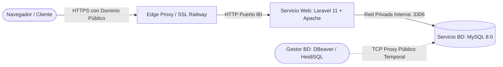

# 🚀 Guía Técnica y Planificación de Despliegue en Railway
### Sistema de Gestión de Cancha Sintética Deportiva (Laravel 11 + MySQL)

* **Proyecto:** Cancha Sintética Deportiva
* **Tecnologías:** Laravel 11 (PHP 8.2+), Vite (Tailwind CSS, Alpine.js), MySQL 8.0
* **Plataforma de Despliegue:** [Railway](https://railway.app)
* **Responsable:** Josue
* **Fecha:** Octubre 2026

---

## 📌 1. Arquitectura General en Railway

Railway organiza los proyectos mediante servicios interconectados dentro de una **red privada interna** de alta velocidad (`.railway.internal`). Para nuestro sistema se desplegarán dos servicios:



1. **Servicio de Base de Datos (MySQL 8.0):**
   - Servicio gestionado nativo de Railway.
   - Enlace privado interno con Laravel: `DB_HOST=${{MySQL.MYSQLHOST}}`.
   - Puerto TCP público temporal para importar el volcado SQL inicial de XAMPP.
2. **Servicio Web (Laravel 11 + Apache):**
   - Compilación multi-etapa con Docker (Node.js para Vite + PHP 8.2 Apache).
   - DocumentRoot apuntando a `/var/www/html/public`.
   - Proxy reverso y forzado HTTPS configurado para evitar errores de contenido mixto (*Mixed Content*).

---

## 🛠️ 2. Detalle de Cambios a Realizar (Qué se modificará y Dónde)

> [!IMPORTANT]
> A continuación se especifican los archivos exactos a modificar y crear en el repositorio antes de hacer el push a GitHub.

### 2.1. Configuración de Proxy Reverso
* **Archivo:** [`bootstrap/app.php`](file:///c:/xampp/htdocs/cancha-sintetica/bootstrap/app.php)
* **Propósito:** Informar a Laravel 11 que confíe en el balanceador y proxy de Railway para que detecte correctamente el protocolo HTTPS y la IP del cliente.
```diff
 ->withMiddleware(function (Middleware $middleware) {
-    //
+    $middleware->trustProxies(at: '*');
 })
```

---

### 2.2. Forzado de Esquema HTTPS en Producción
* **Archivo:** [`app/Providers/AppServiceProvider.php`](file:///c:/xampp/htdocs/cancha-sintetica/app/Providers/AppServiceProvider.php)
* **Propósito:** Asegurar que los helpers `route()`, `asset()`, `Storage::url()` y la paginación generen siempre URLs con `https://`, previniendo bloqueos del navegador por contenido mixto.
```diff
 public function boot(): void
 {
     Paginator::useTailwind();
     Carbon::setLocale('es');
+
+    if ($this->app->environment('production') || env('APP_ENV') === 'production') {
+        \Illuminate\Support\Facades\URL::forceScheme('https');
+    }
 }
```

---

### 2.3. Definición del Contenedor de Producción
* **Archivo:** `Dockerfile` *(Archivo nuevo en la raíz del proyecto)*
* **Propósito:** Compilar los assets con Vite en Node 20 y empaquetar la aplicación en PHP 8.2 con Apache y extensiones MySQL (`pdo_mysql`, `mbstring`, `gd`, `zip`, `bcmath`).

```dockerfile
# Etapa 1: Compilación de Frontend con Node.js y Vite
FROM node:20-alpine AS node-builder
WORKDIR /app
COPY package*.json ./
RUN npm ci
COPY . .
RUN npm run build

# Etapa 2: Servidor PHP 8.2 con Apache
FROM php:8.2-apache

RUN apt-get update && apt-get install -y \
    git \
    curl \
    libpng-dev \
    libonig-dev \
    libxml2-dev \
    libzip-dev \
    zip \
    unzip \
    && docker-php-ext-install pdo_mysql mbstring exif pcntl bcmath gd zip \
    && apt-get clean && rm -rf /var/lib/apt/lists/*

RUN a2enmod rewrite

COPY --from=composer:2 /usr/bin/composer /usr/bin/composer

WORKDIR /var/www/html

COPY . .
COPY --from=node-builder /app/public/build ./public/build

RUN composer install --no-dev --optimize-autoloader --no-interaction

COPY docker/apache.conf /etc/apache2/sites-available/000-default.conf

RUN chown -R www-data:www-data /var/www/html/storage /var/www/html/bootstrap/cache \
    && chmod -R 775 /var/www/html/storage /var/www/html/bootstrap/cache

COPY docker/run.sh /usr/local/bin/run.sh
RUN chmod +x /usr/local/bin/run.sh

EXPOSE 80

ENTRYPOINT ["/usr/local/bin/run.sh"]
```

---

### 2.4. Configuración del Servidor Web Apache
* **Archivo:** `docker/apache.conf` *(Archivo nuevo)*
* **Propósito:** Configurar Apache para que el `DocumentRoot` sea estrictamente `/var/www/html/public` con reescritura habilitada para el enrutador de Laravel.

```apache
<VirtualHost *:80>
    ServerAdmin webmaster@localhost
    DocumentRoot /var/www/html/public

    <Directory /var/www/html/public>
        Options -Indexes +FollowSymLinks
        AllowOverride All
        Require all granted
    </Directory>

    ErrorLog ${APACHE_LOG_DIR}/error.log
    CustomLog ${APACHE_LOG_DIR}/access.log combined
</VirtualHost>
```

---

### 2.5. Script de Inicialización y Caché
* **Archivo:** `docker/run.sh` *(Archivo nuevo)*
* **Propósito:** Ejecutar al iniciar el contenedor: el enlace simbólico del storage (`storage:link`), el pre-cacheo de rutas, configuración y vistas, y arrancar Apache.

```bash
#!/bin/bash
set -e

echo "==> Iniciando Cancha Sintética en Railway..."

# Enlace simbólico de storage para imágenes
php artisan storage:link || true

# Optimización de caché
php artisan config:cache
php artisan route:cache
php artisan view:cache

echo "==> Laravel optimizado correctamente. Arrancando Apache..."
exec apache2-foreground
```

---

### 2.6. Archivo de Exclusiones de Docker
* **Archivo:** `.dockerignore` *(Archivo nuevo en la raíz)*
* **Propósito:** Acelerar el despliegue impidiendo que se envíen al build carpetas locales innecesarias (`node_modules`, `vendor`, `.env` con datos de XAMPP local).

```text
/vendor
/node_modules
/.git
.env
.env.*
!.env.example
/tests
npm-debug.log
yarn-error.log
.phpunit.result.cache
database/database.sqlite
```

---

### 2.7. Respaldo y Migración de la Base de Datos
* **Archivo:** `database/canchasintetica_backup.sql`
* **Propósito:** Como la carpeta `database/migrations` está vacía, se exporta un volcado completo con estructura y datos de `canchasintetica_db` desde XAMPP para importarlo en Railway.
* **Comando:**
  ```powershell
  c:\xampp\mysql\bin\mysqldump.exe -u root --default-character-set=utf8mb4 canchasintetica_db > database\canchasintetica_backup.sql
  ```

---

## 📋 3. Paso a Paso Detallado para Subir Todo a Railway

### Fase 1: Respaldo de la Base de Datos Local
1. Comprobar que MySQL de XAMPP esté encendido.
2. Abrir PowerShell en la raíz del proyecto y exportar la base de datos:
   ```powershell
   c:\xampp\mysql\bin\mysqldump.exe -u root --default-character-set=utf8mb4 canchasintetica_db > database\canchasintetica_backup.sql
   ```
3. Verificar que `canchasintetica_backup.sql` contiene las tablas (`usuarios`, `reservas`, `torneos`, `equipos`, `jugadores`, `partidos`, etc.).

---

### Fase 2: Creación del Servicio MySQL en Railway
1. Iniciar sesión en [railway.app](https://railway.app).
2. Hacer clic en **+ New Project** -> **Provision MySQL**.
3. En la tarjeta del servicio MySQL:
   - Ir a la pestaña **Variables**: tomar nota de `MYSQLHOST`, `MYSQLPORT`, `MYSQLUSER`, `MYSQLPASSWORD`, `MYSQLDATABASE`.
   - Ir a la pestaña **Settings** -> **Networking** -> Hacer clic en **Add TCP Proxy** o **Generate Domain** para obtener la dirección y puerto públicos temporales de conexión externa.

---

### Fase 3: Importación de la Base de Datos a Railway
Conectar con DBeaver, HeidiSQL o mediante consola ejecutando:
```powershell
c:\xampp\mysql\bin\mysql.exe -h [HOST_PÚBLICO] -P [PUERTO_PÚBLICO] -u [MYSQLUSER] -p[MYSQLPASSWORD] [MYSQLDATABASE] < database\canchasintetica_backup.sql
```
Verificar que todas las tablas y datos del proyecto aparezcan en la base de datos de Railway.

---

### Fase 4: Preparación del Repositorio Git
1. Crear los archivos de despliegue (`Dockerfile`, `docker/apache.conf`, `docker/run.sh`, `.dockerignore`).
2. Aplicar los ajustes en `bootstrap/app.php` y `app/Providers/AppServiceProvider.php`.
3. Hacer commit y push a GitHub:
   ```bash
   git add .
   git commit -m "feat: preparar despliegue en Railway con Docker y MySQL"
   git push origin main
   ```

---

### Fase 5: Conectar GitHub y Crear el Servicio Web en Railway
1. En el mismo proyecto de Railway (donde está MySQL), hacer clic en **+ New Service**.
2. Seleccionar **GitHub Repo** y elegir el repositorio `cancha-sintetica`.
3. Railway detectará automáticamente el `Dockerfile` y comenzará el build.

---

### Fase 6: Configurar las Variables de Entorno en Railway
En la tarjeta del servicio web Laravel -> pestaña **Variables** -> **Raw Editor**, pegar lo siguiente:

```env
APP_NAME="Cancha Sintetica Deportiva"
APP_ENV=production
APP_KEY=base64:xvu+aEMTRSwoynJG5Y1uXSd+Yt2CZlnWvE/sp9pv4j4=
APP_DEBUG=false
APP_URL=https://${{RAILWAY_PUBLIC_DOMAIN}}

DB_CONNECTION=mysql
DB_HOST=${{MySQL.MYSQLHOST}}
DB_PORT=${{MySQL.MYSQLPORT}}
DB_DATABASE=${{MySQL.MYSQLDATABASE}}
DB_USERNAME=${{MySQL.MYSQLUSER}}
DB_PASSWORD=${{MySQL.MYSQLPASSWORD}}

SESSION_DRIVER=database
SESSION_LIFETIME=120
SESSION_ENCRYPT=false

CACHE_STORE=database
QUEUE_CONNECTION=database
FILESYSTEM_DISK=public

LOG_CHANNEL=stderr
LOG_LEVEL=info
```

> [!TIP]
> Las variables `${{MySQL.MYSQLHOST}}` enlazan dinámicamente con el servicio MySQL dentro de la red privada interna de Railway.

---

### Fase 7: Dominio Público y Verificación
1. En el servicio web -> pestaña **Settings** -> **Networking** -> **Generate Domain**.
2. Railway asignará una URL pública (ejemplo: `https://cancha-sintetica-production.up.railway.app`).
3. En la pestaña **Deployments**, revisar los logs en tiempo real para verificar que Vite compiló los assets y Apache arrancó sin errores.
4. Abrir la URL en el navegador y probar:
   - Navegación pública (Inicio, Horarios, Torneos, Anuncios, Contacto).
   - Login de los tres roles (`admin@cancha.com`, `carlos@org.com`, `juan@cancha.com`).
   - Crear una reserva y verificar su visualización en el calendario interactivo.

---

## 🔍 4. Resolución de Problemas Frecuentes (Troubleshooting)

| Síntoma | Posible Causa | Solución |
| :--- | :--- | :--- |
| **Error 500 al abrir la web** | `APP_KEY` ausente o no definida. | Verificar que `APP_KEY` esté configurada en la pestaña *Variables* del servicio web. |
| **Error 403 Forbidden** | Apache apuntando a `/` en vez de `/public`. | Verificar que `docker/apache.conf` tenga `DocumentRoot /var/www/html/public`. |
| **Mixed Content (CSS/JS no cargan)** | Peticiones HTTP generadas detrás de proxy SSL. | Asegurarse de tener `trustProxies(at: '*')` en `bootstrap/app.php` y `URL::forceScheme('https')` en `AppServiceProvider.php`. |
| **Imágenes de galería/anuncios en 404** | Enlace simbólico de storage desvinculado. | `docker/run.sh` ejecuta `php artisan storage:link || true` al arrancar el contenedor. |
| **SQL Connection Refused** | Credenciales de base de datos incorrectas. | Usar las variables de referencia dinámica `${{MySQL.MYSQLHOST}}`, `${{MySQL.MYSQLPASSWORD}}`, etc. |
